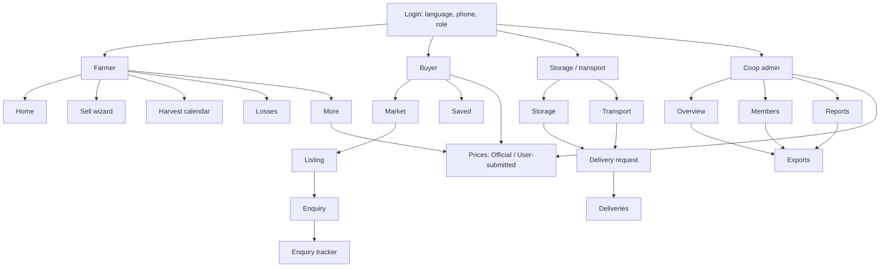

# Information architecture

## Sitemap
```
Login / language / role
|- Farmer:  Home | Sell (5-step) | Harvest calendar | Losses | More: My produce, Enquiries, Prices, Storage, Transport, Deliveries, My data, Alerts
|- Buyer:   Market (search/filter/compare) > Listing detail > Enquiry | Saved suppliers | Enquiries (tracker) | Prices | More: Alerts, My data
|- Storage/transport: Storage directory | Transport directory > Delivery request | Deliveries (status) | Alerts
|- Coop admin: Overview | Members | Reports (loss, export) | Prices | More: Alerts, My data
Shared: Prices (Official | User-submitted), Alerts + channel settings, My data (export, deletion request)
```


## Per-role navigation
| Role | Mobile bottom bar (max 5) | Desktop side nav |
|---|---|---|
| Farmer | Home, Sell (raised), Harvest, Losses, More | all 12 |
| Buyer | Market, Saved, Enquiries, Prices, More | 6 |
| Storage/transport | Storage, Transport, Deliveries, Alerts | 4 |
| Coop admin | Overview, Members, Reports, Prices, More | 7 |

## Principles
- One primary action per home screen. Max depth 3 taps for any daily task.
- Role is fixed per account (a coop admin can also hold a farmer profile later: open question).
- Global controls in the top bar: offline state, language (EN/SW), theme, alerts.
- Hash routes in the prototype: `#/<role>/<screen>[/<id>]`.
- Official and user-submitted prices are separate screens/tabs everywhere, including notifications ("Official ..." prefix).

## Data classification shown in UI
Every demo screen carries "Synthetic demonstration data. Simulated - design prototype." Official price rows read "Sample bulletin (synthetic)". In the build, each record has an origin field: officially published, user-submitted, synthetic.
